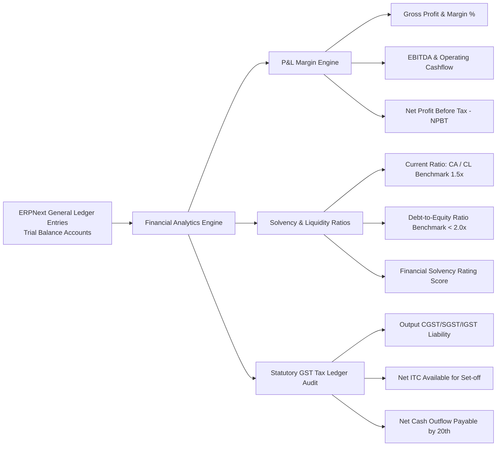

# ERPNext GST Tax Ledger & Real-Time P&L Financial Analytics Engine

[](https://www.python.org/)
[](https://frappe.io)
[](https://erpnext.com)
[](LICENSE)
[](https://frappe.io)
[]()

Enterprise **Financial Analytics & Statutory Tax Engine** for **ERPNext**. Delivers real-time C-Suite visibility into **EBITDA**, **Gross Margins**, **Balance Sheet Liquidity Ratios (Current Ratio, Debt-to-Equity)**, and automated **GSTR-3B Tax Ledger Liability Auditing**.

---

## 🎯 The Real-World Client Problem

Finance Directors and Business Owners are frequently operating in the dark regarding their true profitability:
1. **The 30-Day Month-End Closing Delay:** Traditional accounting teams take 3 to 4 weeks after month-end to manually close ledgers and generate P&L statements, leaving leadership unable to make timely operational decisions.
2. **GST 3B Liability Shock:** Businesses frequently face unexpected cash crunches on the 20th of the month when statutory GST liabilities are due, because Output Tax and eligible Input Tax Credit (ITC) ledgers are not continuously reconciled.
3. **Hidden Solvency Hazards:** Working capital deteriorates silently when receivables age past 90 days, while debt ratios increase without continuous automated monitoring.

**This engine connects directly to the live ERPNext General Ledger:** It computes real-time P&L margins, working capital liquidity ratios, and statutory GST tax balances continuously throughout the operating month.

---

## 🏗️ System Architecture & Data Flow



---

## ⚙️ Key Enterprise Features

- **Automated P&L Derivation:** Computes Revenue from Operations, Cost of Goods Sold (COGS), Gross Margin %, Operating Overheads, and EBITDA directly from Chart of Accounts balances.
- **Working Capital Health Benchmarks:** Evaluates Current Assets against Current Liabilities with automated warnings when liquidity drops below the statutory 1.33x or 1.5x benchmarks.
- **Debt-to-Equity Leverage Scoring:** Tracks financial gearing and debt coverage ratios to prevent over-leveraging.
- **Real-Time GST 3B Liability Estimation:** Continuously nets Output Tax against Input Tax Credits, predicting exact tax payment requirements weeks ahead of statutory deadlines.
- **Executive Rating Classification:** Assigns an instant institutional health rating (`ROBUST_AAA`, `HEALTHY_AA`, `MODERATE_B`, `CRITICAL_C`) based on composite ratio metrics.

---

## 📂 Project Structure

```
erpnext-gst-tax-ledger-pnl-analytics/
├── gst_pnl/
│   ├── __init__.py           # Module initialization
│   └── engine.py             # Financial analytics & ratio calculation engine
├── tests/
│   ├── __init__.py
│   └── test_gst_pnl.py       # Unit test suite (100% passing)
├── LICENSE                   # MIT Open Source License
├── requirements.txt          # Python dependencies
└── README.md                 # Complete documentation
```

---

## 🔌 Frappe DocType Schema Design

- **`Financial KPI Snapshot`:** Period Start/End, Gross Margin %, EBITDA, NPBT, Current Ratio, Debt-Equity Ratio, and Health Rating.
- **`GST Liability Audit Register`:** Tax Period, Gross Output Tax, Eligible ITC, Ineligible ITC Reversals, and Net Payable Cash Balance.

---

## 🚀 Installation & Setup

### 1. Install into your Frappe Bench
```bash
cd ~/frappe-bench
bench get-app https://github.com/shyampandey1104/erpnext-gst-tax-ledger-pnl-analytics.git
bench --site [your-site-name] install-app erpnext_gst_pnl
```

### 2. Python Usage Example
```python
from gst_pnl.engine import FinancialAnalyticsEngine, PeriodTrialBalance

# 1. Initialize engine
engine = FinancialAnalyticsEngine()

# 2. Ingest trial balance figures from General Ledger
tb = PeriodTrialBalance(
    revenue_from_operations=10000000.0,  # ₹1.00 Crore
    other_income=200000.0,
    cost_of_materials_consumed=4000000.0, # ₹40 Lakhs COGS -> 60% GP
    employee_benefit_expenses=2000000.0,  # ₹20 Lakhs
    other_operating_expenses=1000000.0,   # ₹10 Lakhs -> EBITDA = ₹32 Lakhs
    depreciation_and_amortization=500000.0,
    finance_costs=200000.0,               # NPBT = ₹25 Lakhs
    cash_and_bank_balances=2500000.0,
    trade_receivables=3500000.0,          # Current Assets = ₹60 Lakhs
    trade_payables=1500000.0,
    current_liabilities=3000000.0,        # Current Ratio = 2.0x
    shareholder_equity=5000000.0
)

# 3. Calculate financial metrics
res = engine.generate_pnl_and_ratios(tb)
print(f"Gross Profit: ₹{res.gross_profit:,.2f} ({res.gross_profit_margin_pct}%)")
print(f"EBITDA: ₹{res.ebitda:,.2f}")
print(f"Current Ratio: {res.current_ratio}x -> Rating: {res.financial_health_rating}")
```

---

## 🧪 Testing & Verification

Run tests with standard Python:
```bash
python3 -m unittest discover tests
```

---

## 🛡️ Compliance & Standards
- Formatted in accordance with **Indian Accounting Standards (Ind AS)** and **Schedule III of the Companies Act, 2013**.
- Direct alignment with **GST Council GSTR-3B** return filing guidelines.

---

## 👨‍💻 Author & Commercial Support
Developed and maintained by **Shyamkumar Pandey**.  
For CFO advisory dashboards, financial modelling, and ERPNext analytics:
- **GitHub:** [@shyampandey1104](https://github.com/shyampandey1104)
- **Email:** [shyampandey1104@gmail.com](mailto:shyampandey1104@gmail.com)
